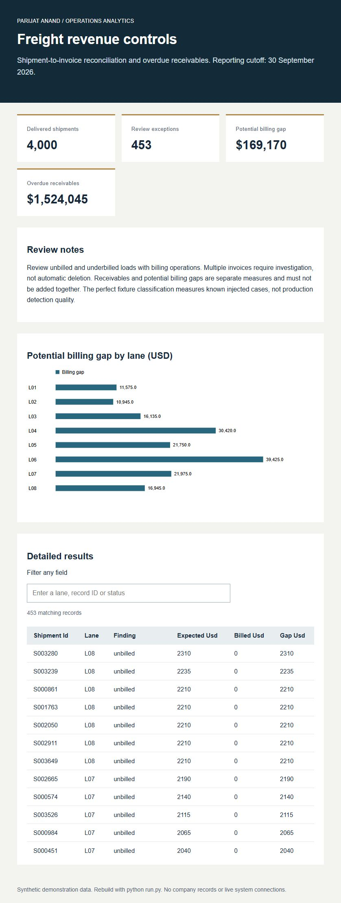
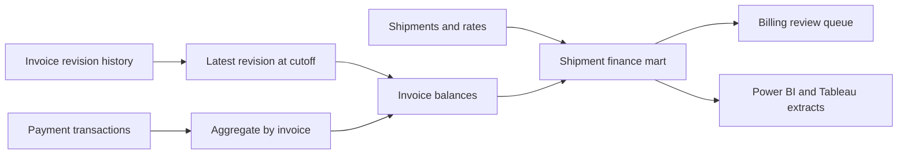

# Freight revenue controls

A delivered load can appear in an operations report while its revenue is missing,
underbilled or counted twice. This project reconciles shipments, effective-dated
rates, invoice revisions and payment transactions into a billing review queue.

The intended users are a billing analyst and an operations manager reviewing the
same load. Each finding retains the shipment, lane, expected amount and billed
amount, so the analyst can explain the difference without rebuilding a spreadsheet.



## Run it

Python 3.10 or newer. No third-party packages or account credentials are required.

```bash
python -m unittest discover -s tests -v
python run.py
```

Open `build/index.html` in a browser. Filter by shipment, lane or finding.
The same command produces a SQLite warehouse, three CSV extracts and `metrics.json`.
The checked-in [sample report](sample/index.html) can be downloaded and opened directly.

## What the sample demonstrates

| Measure | Reproducible result |
|---|---:|
| Delivered shipments | 4,000 |
| Billing exceptions | 453 |
| Potential billing gap | $169,170 |
| Overdue invoice balance at 30 September 2026 | $1,524,045 |

These are synthetic records generated with seed 29. The billing gap is an amount
to investigate, not recovered revenue. The overdue balance is a separate metric.
The controls identify every deliberately injected finding in this fixture; that
does not establish accuracy on unknown production errors.

## Design



- SQL window functions select the latest eligible invoice revision.
- Payments aggregate before invoice joins, preventing split-payment fan-out.
- Effective-date joins use an inclusive start and exclusive end. Missing or
  overlapping rates stop the run.
- Monetary calculations use integer cents. A one-dollar comparison tolerance is explicit.
- Replaying the fixture does not append duplicate invoices or receipts.
- CI runs the tests and rebuilds the report on changes and each Monday.

The model is deliberately local and inspectable. SQLite is suitable for the demo;
it is not evidence of warehouse-scale performance. Production ingestion would need
source watermarks, correction handling, access controls and reconciliation sign-off.

## Review the work

- [SQL schema](sql/schema.sql) and [reporting queries](sql/marts.sql)
- [Business definitions and acceptance criteria](docs/controls.md)
- [Power BI and Tableau setup](bi/README.md)
- [Operating procedure](docs/runbook.md)
- [Development workflow](docs/development.md)

## Boundaries

The fixture assumes one expected customer invoice per delivered load. Split billing,
credit notes, tax, currency conversion, fuel-index changes and disputed balances
need separate rules before production use. Multiple invoices are flagged for review,
not automatically removed. No employer data, source code or private system details
are included.
